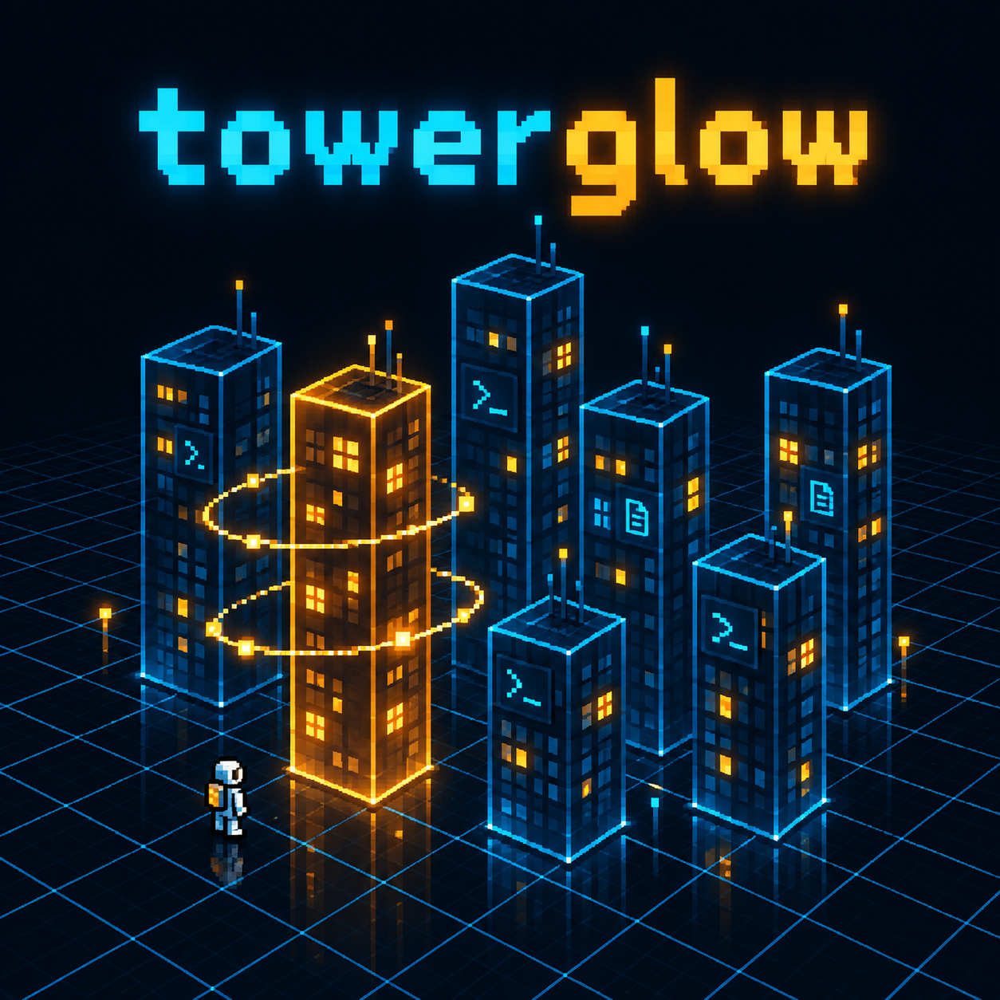
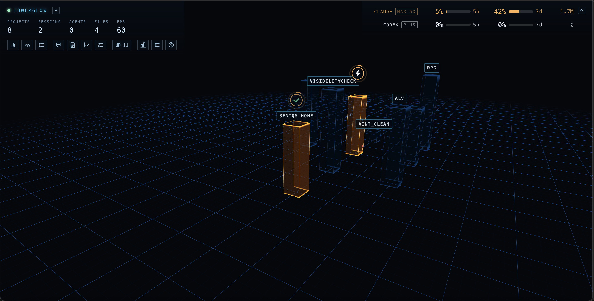

# Towerglow

<p align="center">
  
</p>

Towerglow draws your Claude Code and Codex sessions as a living 3D city, in a
browser tab on your own machine. Every project you work in is a tower; its
windows light up while agents read, edit and run commands in it, and every
commit rings around it. A second view, the colony, shows the same data as a
small space colony with an astronaut for each session.

It works by reading the files the two command-line tools already leave on
your disk. Out of the box it is an observatory and nothing more: it makes no
network connections, calls no model, and writes nothing outside its own
folder.

Towerglow is an independent project, not affiliated with Anthropic or OpenAI.

## Two modes

Towerglow starts as a read-only observatory. An optional module, the CEOs,
adds two AI advisors that can also start work in your projects. It is off
unless you start with `--ceo`.

| | Observatory (default) | With the CEOs (`--ceo`) |
| --- | --- | --- |
| Network | None. The server listens on `127.0.0.1` only | Your own `claude` and `codex` CLIs talk to Anthropic and OpenAI, as they do when you use them |
| Model calls | Never | When you ask something, and the workers you approve |
| Your projects | Never written. File contents are never read | The CEOs can read your code; workers you approve edit it, commit and push |
| Your plan's quota | Untouched | Used, within limits you set |

What the observatory reads, shows and stores is in [PRIVACY.md](PRIVACY.md).
What turning on the CEOs implies, and how to keep it under control, is in
[docs/ceo-mode.md](docs/ceo-mode.md). Read that page before using `--ceo`.

## Quick start

You need macOS or Linux, [Node.js](https://nodejs.org) 22.18 or newer, and
Claude Code and/or Codex installed and used at least once: Towerglow shows
the sessions they record.

```bash
git clone https://github.com/seniqs-as/towerglow.git
cd towerglow
npm install
npm run build
node bin/towerglow.mjs start
```

`start` prints the address to open, with an access token in it:

```
  TOWERGLOW
  open:      http://127.0.0.1:7317/?t=...
```

The token is created on the first start, kept in `~/.towerglow/token`, and
stays the same across restarts. It keeps other programs on your machine from
reading the page's data. To open the page without copying it:

```bash
open "http://127.0.0.1:7317/?t=$(cat ~/.towerglow/token)"      # macOS
xdg-open "http://127.0.0.1:7317/?t=$(cat ~/.towerglow/token)"  # Linux
```

Stopping, restarting, running in the background and every option are in
[docs/running.md](docs/running.md).

## What you see

The page opens on the **city**: one tower per project, windows lit by the
work, a light scene that runs anywhere. **V** (or the button beside Settings)
switches to the **colony**, the full 3D view with many more polygons, and
back.



Keys in the page: drag to move, scroll to zoom at the cursor, **C** frames the
whole map. In the colony, **H** frames the ship, **P** cycles the planet, **T**
the time of day and **O** orbits. With the CEOs, **E** walks you up the ramp
into the ship, where the CEOs sit at their desk: walk up to it (WASD or the
arrows) and the planning panel opens; **E** or the hatch takes you back out.

The legend button explains every colour and sign of the view on screen; the
settings button holds the tower spacing, the quality presets, the planet and
the sky. On macOS, clicking a session brings its terminal window to the front.

## Privacy in short

- **It reads** the session records and transcripts of Claude Code
  (`~/.claude`) and Codex (`~/.codex`), the branch and reflog of your
  projects' git repositories, and the names of the files in your projects, to
  size the towers. It never reads the contents of your project files, nor the
  text of Claude's replies.
- **It shows**, in a page served only to your own machine, metadata: project
  names, session titles, which tools run on which files, token counts, commit
  subjects. Flags like `--redact-paths`, `--no-titles` and
  `--no-commit-text` hide more.
- **It writes** only `~/.towerglow`. It changes `~/.claude/settings.json`
  only if you run `towerglow statusline install`, and puts it back with
  `towerglow statusline uninstall`.
- **It sends** nothing. No telemetry, no update checks, no fonts or scripts
  from the internet.

Details, and the exact list of what reaches the page, in
[PRIVACY.md](PRIVACY.md).

## Quota bars (optional)

Claude Code hands your 5-hour and 7-day usage to its status line command and
writes it nowhere else. To show it, Towerglow can sit in front of your status
line:

```bash
node bin/towerglow.mjs statusline install    # backs up settings.json first
node bin/towerglow.mjs statusline uninstall  # puts your status line back
```

Your own status line keeps running inside the bridge, and what it prints is
still what you see. Codex's usage comes from its own files and needs nothing.

## The CEOs in short

With `--ceo`, two advisors join the city, one for each tool: you can ask
them about your sessions and spending (the **Board**), plan work with them in
a meeting (**Planning**), and read how the accepted work went (**Reports**).

They run through your own `claude` and `codex` command-line tools and their
login: Towerglow handles no API keys. A model is called only when you ask
something, or to run work you approved. What you should know first:

- **The model provider sees your code.** The CEOs can read the projects in
  the city, and workers work on them directly.
- **Accepted work changes your repositories.** By default a worker commits
  and pushes to the branch the repository is on. You can untick both, per
  project, before approving a plan, and you see everything a worker will be
  told before you say yes.
- **Workers are sandboxed.** Each Claude worker runs in Claude Code's OS
  sandbox: its commands write only in the project, cannot read your
  credentials and reach no network, except `git push` and `git pull` when
  push is ticked.
- **It uses your quota.** A reserve, a cap on each CEO call and a quota
  ceiling keep it in bounds, but workers are real sessions and cost what a
  session costs.

The CEOs need Claude Code 2.1.285 or newer and/or Codex; on Linux the
workers' sandbox also needs `bubblewrap` and `socat`. To try them as advisors
only, with nothing ever started:

```bash
node bin/towerglow.mjs start --ceo --no-execute
```

Everything else, including what each process is allowed to do, is in
[docs/ceo-mode.md](docs/ceo-mode.md).

## Development

```bash
npm test               # node --test
npm run typecheck      # server and client
npm run check:deps     # the runtime dependency tree must be exactly {ws}
npm run check:bundle   # the client bundle must contain no way out to the network
npm run check:passive  # the server must build without src/server/ceo/
```

The server is Node with a single runtime dependency, `ws`; the client is
three.js, bundled with Vite. The CEO module lives entirely in
`src/server/ceo/` plus four panels in `src/client/ui/`, and the observatory
builds and runs without it.

## Security

How Towerglow protects your data, and its known limits, are in
[SECURITY.md](SECURITY.md), together with how to report a vulnerability.

## Credits and licence

Towerglow is released under the [MIT licence](LICENSE), copyright Seniqs AS.

The colony scene comes from
**[Bot Crossing](https://github.com/Station-Sciences/bot-crossing)** by
Jarren Rocks (MIT). Three of the four 3D models are built from CC0 asset packs
by **[Kay Lousberg](https://kaylousberg.com)** and are not covered by the MIT
licence: see [src/client/assets/CREDITS.md](src/client/assets/CREDITS.md).
Full notices in [THIRD_PARTY_NOTICES.md](THIRD_PARTY_NOTICES.md).
